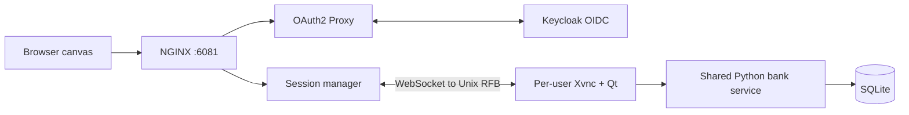

# swag

Qt 5 / C++23 portfolio-management implementation lab, running on AlmaLinux 8.10
with GCC Toolset 15 and Python 3.12. The browser displays a server-rendered Qt
desktop through noVNC and TigerVNC over private Unix sockets.

The approved scope is in [SPEC.md](SPEC.md); the short checklist is in
[TODO.md](TODO.md). Runtime logs and screenshots go under ignored `artifacts/`.

The first rendering gate selected **TigerVNC**. The packaged Qt VNC plugin failed
wheel scrolling, non-Latin-1 keyboard input, and both clipboard directions. The
selected TigerVNC path passes the browser interaction/lifecycle checks over a Unix
socket. See [the short decision record](docs/decisions/rendering.md).
Integration lessons, resolved review findings, evidence and remaining limits are
collected in [Findings and limits](docs/findings.md).

## Authenticated workspace

Requires a running Podman Linux engine, Python 3.12, uv, CMake >=3.25,
and Ninja on the host. The application itself builds inside AlmaLinux 8.10 using
GCC Toolset 15; no host Qt SDK is needed. Native ARM64 containers are verified.
Browser checks were verified with Google Chrome on macOS. The rendering harness
can select Playwright Chromium on Linux; workspace browser checks currently
select Chrome explicitly.

```sh
uv sync --locked
cmake --preset container
cmake --build --preset container --target app-build
cmake --build --preset container --target app-up
```

Open <http://localhost:6081>. Synthetic logins: **alice / demo** and **bob / demo**.
Use separate browser profiles/private windows to compare them. Start a workspace,
edit rows or leave an unsaved note, then reload/reconnect. A second viewer takes
control of the same process. Quit stops the workspace; starting another requires
an explicit click. “End session & sign out” stops Qt and removes the app login.
Identity-provider SSO is separate and may still remember the user.

To use multiple MDI child frames with no external window manager:

```sh
cmake --build --preset container --target app-up-mdi
# Equivalent direct command:
python3.12 tools/app.py up --ui-mode mdi
```

Select an entity to open or activate its frame. **Open new window** opens an
independent copy, so several forms for the same entity can remain open with
different unsaved edits. Use Tile, Cascade, the child title bars, or Maximize
active/Restore active to arrange them. Ctrl+Tab switches frames, Ctrl+W closes
the active frame, and Ctrl+N opens another copy. Closing a dirty frame asks before
discarding; Quit checks every frame. Closing the last child leaves the shell
running. Reconnecting preserves the frame layout and unsaved forms.

The authenticated desktop resizes to the available browser canvas on connection
and when the browser window changes size. The Qt root follows that display size;
the running process and unsaved forms remain. Reconnecting or taking over from a
different-sized viewer uses the new viewer's dimensions. Normal MDI children keep
their sizes where possible; use Tile or Maximize active to rearrange them.
Below an 800×600 canvas, the client scales the existing desktop to keep all
controls visible; normal remote resizing resumes when more space is available.

The default `app-up` (or `--ui-mode single`) keeps the original single-view UI
with Openbox. MDI defaults to `--window-manager none`; an explicit
`--window-manager openbox` overrides that choice. Changing mode recreates the
stack and ends running workspaces, preserving database records. Both modes still
use Xvnc, Qt/xcb and vncconfig inside the container; MDI removes Openbox from that
path. It does not remove internal X11.



NGINX overwrites identity headers after authentication. The manager validates its
private proxy credential, binds the user to one generation, and serializes starts.
Stable launcher/Qt locks and Linux parent-death signals cover process ownership.
All GUI processes run as UID1000 in one app-host container. This proves application
session ownership; a shared UID is not an OS security boundary between users.
Only NGINX publishes a host port, bound to loopback. Bank, manager, IdP, RFB and
X11 listeners remain private; RFB and X11 TCP are disabled.

SQLAlchemy domain metadata generates CRUD/schema/validation and the Qt grids and
forms. The shared service enforces portfolio permissions, optimistic versions,
trusted actor fields and exact scaled-integer decimals. Alice and Bob share one
portfolio and each has a private portfolio. Additional grids cover mandates,
instruments, positions, cash balances, prices and FX rates. Qt uses asynchronous
HTTP, so nanobind is unnecessary for this service boundary.
The bank container has a stable private address to model a shared-service VIP;
NGINX re-resolves its other upstream names when containers restart.

```sh
cmake --build --preset container --target app-check
PYTHONPATH=python .venv/bin/python -m unittest discover -s tests -p 'test_*.py'
cmake --build --preset container --target app-down
```

`app-check` operates the running demo and ends its test workspaces. State, browser
screenshots and results live under `artifacts/workspace-check/`; runtime state and
the persistent DB live under `artifacts/stack/`. `app-down` preserves the DB;
`app-up` recreates containers and ends existing workspaces. Generated secrets are
local ignored files under `artifacts/stack/config/`; keep that directory private.

`app-check` also covers logout/relogin, expired-tab recovery and delayed responses
during sign-out. Run only those login checks (using Bob's workspace) with
`cmake --build --preset container --target app-login-check`; evidence is under
`artifacts/login-state/`.

Additional fault checks operate on this local demo (run them with idle workspaces):

```sh
.venv/bin/python tests/linux_ownership.py
.venv/bin/python tests/browser/uncertain_write.py
.venv/bin/python tests/browser/uncertain_write.py --ui-mode mdi
.venv/bin/python tests/startup.py
```

They check supervisor/manager death, a committed create with a delayed response,
and failed startup components. The startup check recreates the whole demo and
restores a healthy stack. Each check retains results under `artifacts/`.

Verified on native ARM64: 24 service/launcher tests, 11 workspace and 5 login browser checks,
8 Linux ownership checks, uncertain-write reconciliation and all three injected
application-component startup failures. A fresh OIDC login/canvas check follows
restoration. These are functional local checks, not production qualification.
MDI additionally passes 10 frame checks without Openbox; resize checks pass 6/6
in each UI mode, including small-window scaling and state-preserving takeover.

With the demo running in MDI mode, use
`cmake --build --preset container --target app-mdi-check` for frame layout,
independent edits, dialogs/focus, clipboard, reconnect and lifecycle checks.
Evidence is under `artifacts/mdi-check/`. The MDI uncertain-write fixture also
checks closing during a read and close/Quit guards during a write; it uses an
isolated static-identity workspace on port 6083 and cleans up its rows/containers.
Run `cmake --build --preset container --target app-resize-check` to check initial
fit, browser resizing with unsaved forms/open dialogs, reconnect and takeover.
It works in either UI mode; evidence is under `artifacts/resize-{mode}-check/`.

This is a local HTTP demo with a real OIDC protocol flow and synthetic identities.
Entra tenant integration, external HTTPS, multi-host ownership/failover, native
keyboard layouts/IMEs, CJK fonts and WAN/performance qualification remain future
work. A timed-out write retains its form and blocks mutations until explicit
discard/reload; backend idempotency is not implemented. Authentication sidecars
use pinned upstream images; the application, bank and edge images use EL8.

## Rendering comparison

```sh
cmake --build --preset container --target probe-image
python3.12 tools/probe.py run
```

Open <http://127.0.0.1:6080/probe.html>. The default is TigerVNC over
`/run/swag/users/probe/vnc.sock`; only the browser port is published, on host
loopback. This is a private rendering probe without authentication. Disconnecting
the viewer preserves the draft; Quit ends the application and its container.

```sh
python3.12 tools/probe.py stop
```

Run the selected backend's browser checks:

```sh
# Linux hosts without an existing Playwright browser: uv run playwright install chromium
cmake --build --preset container --target probe-check
```

`probe-check` builds the image and runs the TigerVNC Unix-socket checks. Results,
screenshots, browser traces and version manifests are written below `artifacts/`.
The tests remove their own containers, including failed runs.

To repeat the comparison:

```sh
cmake --build --preset container --target probe-compare
```

This runs both candidates over TCP. The current Qt candidate produces a nonzero
status for its feature failures. Inspect per-backend results to distinguish those
from harness or TigerVNC failures.
Use `--engine docker` with `tools/probe.py` and `tests/browser/smoke.py`, or select
`-DSWAG_ENGINE=/path/to/docker` when configuring CMake, to use Docker instead of
Podman. The Docker adapter remains unverified for both the renderer and workspace.

Clipboard checks use the visible noVNC clipboard controls. Unicode checks dispatch
browser keyboard events for `é€Ж`; native keyboard layouts, IMEs, CJK font coverage,
and WAN performance require separate qualification.
