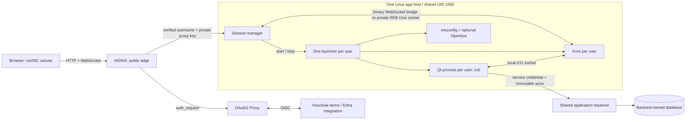

# Hosting an existing multi-frame Qt 5 application in a browser

This is the porting guide distilled from this repository's working topology.
The application still runs on Linux; the browser receives pixels and sends input.
Start with the existing application's windows and a window manager. Move to MDI
only if removing the window manager is worth the application changes.

## Setup to reproduce



Only NGINX publishes a host port, `127.0.0.1:6081` in the demo. Each username has
its own Qt process, display and RFB socket; all run under one service account.
The session manager selects `/run/swag/users/{user}/{generation}/rfb.sock` from
authenticated identity. NGINX does not construct arbitrary filesystem paths or
route directly to a user-supplied socket. No per-user TCP port or websockify
process is needed. Multiple app hosts would need an additional ownership/routing
design; this implementation proves a single host.

The selected renderer is **TigerVNC**, using Qt's `xcb` platform plugin. The tested
Qt 5.15.3 VNC plugin passed 9/13 interaction checks but failed wheel input,
non-Latin-1 keys and both clipboard directions. TigerVNC passed 13/13 over TCP
and Unix sockets. Qt VNC Unix-socket support was neither patched nor qualified.
These findings concern the tested package; see the [rendering decision](../decisions/rendering.md).
This setup retains internal X11 and needs no host X server or mounted host X socket.

## First run, before replacing the application

From the repository root, with a running Podman Linux engine, Python 3.12, uv,
CMake >=3.25 and Ninja:

```sh
uv sync --locked
cmake --preset container
cmake --build --preset container --target app-build
cmake --build --preset container --target app-up-mdi
```

Open <http://localhost:6081>; use `alice / demo` or `bob / demo`. A separate browser
profile/private window gives the second user a separate login. The exact
`localhost` origin matters for OIDC callbacks, CSRF and WebSocket checks.
`app-up-mdi` starts this demo's MDI UI without Openbox. `app-up` selects its
single-view UI with Openbox. Either up command recreates the stack and ends
workspaces; it preserves database records. `app-down` also preserves the database.

The application/edge images build on AlmaLinux 8.10 with GCC Toolset 15, C++23,
Qt 5.15.3 and Python 3.12. No host Qt SDK is required. Authentication sidecars use
pinned upstream images. Keep the existing application's required Qt modules,
plugins, fonts and native libraries in the image; the demo's package list is a
starting point, not a complete dependency list for another application.

## What to reuse and replace

| Piece | Action for an existing application |
| --- | --- |
| [Containerfile](../../containers/Containerfile), [CMake](../../CMakeLists.txt), [desktop target](../../src/desktop/CMakeLists.txt) | Add/build/install your target and runtime dependencies. The current install path is `/opt/swag/bin/swag-desktop`. Keep the EL8/toolset build environment. |
| [Launcher](../../python/swag_session/launcher.py) | Replace the hard-coded Qt executable/arguments. Preserve process ownership, readiness and cleanup. Launch the foreground process directly; wrappers should `exec`, not daemonize. |
| [Session manager](../../python/swag_session/server.py), [process primitives](../../python/swag_session/processes.py) | Reuse identity binding, serialized starts, generations, locks, leases and Unix-socket bridging. |
| [NGINX template](../../containers/nginx.conf.in), [stack driver](../../tools/app.py) | Replace public origin and OIDC configuration. Preserve header overwrite, exact-origin checks and private upstreams. |
| [Browser shell](../../web/workspace.html) | Reuse noVNC, session recovery, clipboard, resize and fullscreen behavior; adapt branding and the minimum usable canvas size. |
| [Qt desktop](../../src/desktop/main.cpp) | Copy the integration patterns below, replacing generated business panes with your views. `SWAG_UI_MODE` is this demo's code path, not a Qt feature that converts arbitrary windows to MDI. |
| [Mock bank](../../python/swag_bank) | Replace with your shared backend. SQLite and schema-generated CRUD demonstrate data behavior; they are not required by the rendering/session topology. Qt never opens the database. |
| [Rendering probe](../../src/probe), [browser checks](../../tests/browser) | Keep the small renderer gate; adapt application-specific canvas checks and observations to your widgets. |

## Required application contracts

**Identity.** NGINX authenticates and overwrites `X-Swag-User` and
`X-Swag-Proxy-Key`; the private manager validates both. Usernames are stable,
case-sensitive and match `[A-Za-z0-9]{1,32}`. The launcher supplies `SWAG_USER` to
Qt at process creation. RFB does not deliver HTTP headers to Qt. Read identity
once, bind backend requests to it, and avoid a second in-app account switch.
The demo sends `X-Swag-User` plus `X-Swag-Service-Token` to its trusted backend;
the backend enforces permissions. Map Entra identity to the agreed unique username
before launch; the current `preferred_username` mapping is qualified only with
the synthetic Keycloak users. Shared UID processes are trusted: socket modes do
not provide isolation from another process with that same UID.

**Shared-account state.** Audit existing single-instance checks, shared-memory
keys, local IPC names, temporary files and settings that assume one user per OS
account. Namespace user-specific resources with the authenticated username,
not UID/login name. The launcher gives each generation its own XDG config/cache
paths; intentionally persisted user settings need a separate stable per-user
location. `HOME`, the working directory and the default data location remain
shared (`XDG_DATA_HOME` is not set). Check `QSettings`, `QStandardPaths`, relative
files and application-specific locks/`QLocalServer` names; do not accidentally
share them through the service account's home or current directory.

**Zero or one instance.** Acquire a nonblocking, lifetime `flock` on
`SWAG_SESSION_LOCK_FILE` **before `QApplication`**, as `SessionLock` does. Keep
the descriptor open until process exit and never unlink the stable lock file.
The manager also serializes starts, and stable manager/launcher locks protect
their scopes. An in-memory process map alone does not enforce this invariant.
Keep Linux parent-death signals and process-group cleanup. After manager death,
launcher cleanup and a replacement manager can briefly overlap; per-user locks
prevent duplicate ownership, but a start can fail until cleanup releases them.
There is no global handover barrier.

Inventory application-spawned processes too. The launcher arms death signals for
its direct children and cleans their process groups; it does not automatically
supervise helpers spawned by the application. Staying in those groups permits
orderly cleanup, but launcher SIGKILL prevents that cleanup and Qt's death signal
does not automatically cover its forked children. Detached helpers can also
escape normal group cleanup. Define explicit supervision/containment for every
application-spawned helper and test launcher death before claiming none survive.

**Readiness.** The current launcher requires atomic JSON at `SWAG_STATE_FILE`:

```json
{"ready": true, "user": "alice", "generation": "<SWAG_GENERATION>", "pid": 123}
```

Use the actual Qt PID and exact launch generation; publish after the event loop
and root window initialize. The demo uses `QSaveFile`. Its ready flag means GUI
initialization, not backend schema availability: schema loading/errors remain
visible separately. Define any stronger readiness requirement for your app.
The remaining observation fields support tests and are not required by the
launcher. Keep them private; do not expose form contents as a public endpoint.
An open RFB socket alone does not establish that the application initialized.

**Lifetime.** A viewer disconnect preserves the live Qt process and unsaved state.
A second viewer takes over that same process; there is one controlling viewer.
Only an explicit start may create a process. Qt Quit/crash ends its generation,
viewer access and helpers; reconnect must not silently create a replacement.
The shared backend/database survives. Closing the last MDI child leaves the
shell running. The demo's separate browser **End session & sign out** forcibly
ends the workspace, including unsaved edits; it does not pass through Qt's Quit
confirmation and does not globally log out the identity provider.

## Multi-frame Qt choices and pitfalls

**Keep existing top-level windows first.** Run with Openbox while establishing
authentication, input, reconnect and lifetime behavior. The launcher already
supports `SWAG_WINDOW_MANAGER=openbox`; the driver exposes
`--window-manager openbox`. A multi-window application need not become MDI to
use this topology. Preserve its window manager until its dialogs, tool windows
and focus behavior have been qualified without one.

**For MDI, refactor views into child widgets.** Use one root `QMainWindow` with
`QMdiArea` and `QMdiSubWindow` children. Extract view content from top-level
windows and review ownership, window flags, menus, toolbars and close behavior.
Give each child its own model/filter/form/request state, including duplicate
views of the same entity. The demo opens the first frame maximized and additional
frames at bounded cascade positions. It uses `DontMaximizeSubWindowOnActivation`
so selecting another child does not force maximization. Tile/Restore keep users
in control. Qt already supplies the MDI Close shortcut: an extra Ctrl+W binding
caused an ambiguous shortcut. Ctrl+Tab switches children.

**MDI does not absorb every dialog.** `QMessageBox` still creates a top-level
window. Without Openbox, `openMessageBox` uses Qt-drawn frameless dialogs,
window modality, explicit centering/raise/activation, and focus restoration after
dismissal. Screen resizing recenters the active modal. These changes qualify the
demo's message boxes and combo popup, not arbitrary file dialogs or third-party
native windows. Inventory and exercise your application's actual window types.

**Guard close and asynchronous work together.** Preflight all children before
Quit; sequential `closeAllSubWindows` can close some children before another
cancels. Dirty/uncertain forms need a discard decision; active writes block
close. A clean child may close during a read only if callbacks are safely
disconnected/cancelled. The demo disconnects reply callbacks before `abort()`
and uses guarded widget pointers. Preserve these rules when extracting panes.

**Fit the root explicitly without a window manager.** noVNC `resizeSession`
requests an Xvnc framebuffer matching its canvas. Qt `showFullScreen()` alone
did not keep the root fitted after display changes. Follow `QScreen::geometryChanged`
with a queued `setGeometry(screen->geometry())`, and rebind when the window's
screen changes; see `followScreen`, `watchScreen` and `fitScreen`. Recenter modals
and keep the active child reachable after shrink. Other normal children retain
their layout and may need scrolling or Tile. Do not recreate Qt on resize.

## Transport and browser lessons

- Keep `QT_QPA_PLATFORM=xcb`, a unique `DISPLAY` and private per-launch XDG
  config/cache/runtime paths. The launcher starts Xvnc with RFB TCP disabled
  (`-rfbport -1`), `-rfbunixpath`, mode `0600`, and X11 TCP disabled
  (`-nolisten tcp`). Runtime directories are `0700`. Its `SecurityTypes=None`
  and `-ac` rely on the private local sockets/shared-account trust model; they
  are not settings for a public VNC listener.
- Keep `vncconfig -nowin`: it supplies X11 clipboard ownership in this setup.
  Clipboard checks must cover both directions, with real text pasted into Qt.
- Enable noVNC local scaling during resize negotiation. Below the demo's
  800×600 canvas floor, pause remote resizing and scale the whole desktop;
  choose that floor from your app's minimum usable layout. The active viewer
  controls size after takeover. Current sizing uses CSS pixels; HiDPI sharpness
  needs separate qualification.
- Use the browser Fullscreen API from a direct click. Qt fullscreen fills the
  remote display; browser fullscreen removes the browser's own chrome. Keep
  overlay controls inside the fullscreen element so revealing them does not
  resize the framebuffer. Handle rejection and use `document.fullscreenElement`
  as truth. Escape exits locally before reaching Qt; a dialog's Cancel button
  remains available. Login cannot automatically grant a fullscreen gesture.
- Preserve `Cache-Control: no-store` on protected HTML and session responses.
  NGINX location-level `add_header` replaces the inherited list. Keep login
  recovery after 401, restored-page revalidation and rejection of stale
  poll/lease responses during logout; otherwise “Sign in” can survive a login.
- Re-resolve proxy upstream names when containers restart. Existing Qt clients
  retained a stale backend address in our restart check; the demo models a stable
  backend VIP with a fixed private address. Use an equivalent stable endpoint
  or qualify your own discovery/reconnect strategy.
- Keep backend calls off the Qt GUI thread. A timed-out write may already have
  committed: do not automatically retry it. The demo retains the form and
  blocks mutations until explicit discard/reload, without server idempotency
  or an exactly-once guarantee. A reload cannot rule out a later commit.

## Porting gate

Run the existing checks **sequentially** on an idle MDI demo; they change data
and end test workspaces. These four harnesses require installed Google Chrome
(`channel="chrome"`); `uv sync` installs the Python dependencies, not the browser.
Installing Playwright's bundled Chromium alone does not satisfy that selection.

```sh
cmake --build --preset container --target app-mdi-check
cmake --build --preset container --target app-resize-check
cmake --build --preset container --target app-presentation-check
cmake --build --preset container --target app-check
```

Then adapt the checks to the real application. The acceptance gate should cover:

1. Wheel, grid edit/cancel, actual required keyboard layouts/Unicode, text
   clipboard both ways, every popup/dialog type, and focus after dismissal.
2. Two identities, concurrent starts for one identity, attempted cross-user
   access, reload/reconnect/takeover retaining the PID and unsaved forms.
3. Normal Quit, Qt crash, launcher/manager death and failed startup: no surviving
   helpers, no implicit relaunch, database records retained. Use
   [Linux ownership](../../tests/linux_ownership.py) and
   [startup faults](../../tests/startup.py) as reference fixtures.
4. Multiple/duplicate frames, dirty child close, aggregate Quit cancellation,
   close during reads/writes, version conflicts and uncertain write responses.
5. Resize/reconnect at different sizes, a small canvas, an open modal, fullscreen
   entry/exit/rejection and recovery. Check native browser fullscreen visually;
   a headless API/layout assertion alone does not prove OS-level fullscreen.

Results/screenshots live under ignored `artifacts/`; per-generation logs are in
`artifacts/stack/workspaces/users/{user}/{generation}/`. Inspect `launcher.log`,
`launcher.json`, `qt.log`, `xvnc.log` and `vncconfig.log` when launch/input fails.
The persistent mock DB is `artifacts/stack/data/bank.sqlite3`. Protect generated
secrets under `artifacts/stack/config/`; do not copy runtime artifacts into Git.

The measured environment is native ARM64 Podman, AlmaLinux 8.10/GCC 15/Qt 5.15.3,
and Chrome 155 on macOS. Entra, external HTTPS/secure-cookie configuration,
x86_64/Docker, other browsers, IMEs/CJK fonts, WAN performance, capacity and
multi-host failover remain unqualified. Mock SQLite initialization uses
`create_all`, without schema migrations. Detailed results and boundaries are in
[Findings and limits](../findings.md); exact environment/API names are in
[the integration contract](../interfaces.md).
